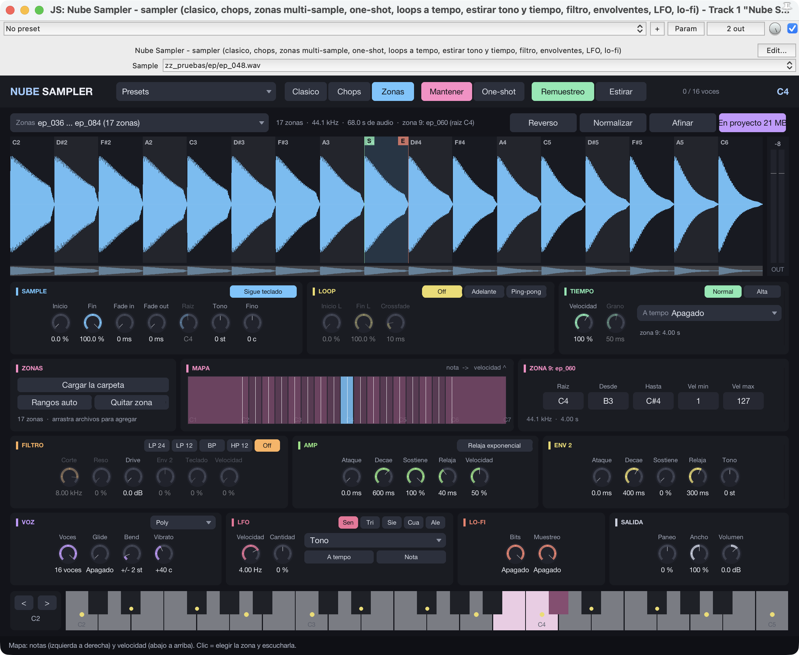

<!-- en -->
# Nube Sampler

A free sampler (instrument) for [REAPER](https://www.reaper.fm), written as a JSFX (macOS / Windows / Linux), part of the
[Nube plugins](https://github.com/KevinMeneses/nube-plugins).


Classic (chromatic), Chops (MPC-style slicer: transients, equal parts or manual, up to 32 slices with per-slice pitch, gain
and reverse) and **Zones** (multi-sample: up to 64 samples, each with its root note, key range and velocity range; a folder
named like `ep_048.wav` or `Rhodes C4.wav` maps itself) modes; hold or one-shot; resample (vinyl) or **stretch** (independent pitch and time, WSOLA) with tempo sync;
forward / ping-pong loops with crossfade; Hermite or anti-aliased Kaiser-sinc interpolation; automatic root-note detection
with one-click tuning; filter, two envelopes, LFO, poly / mono / legato with glide (808 slides), lo-fi (bits and sample rate),
pan, width, normalize; drag-and-drop loading, all the audio can be stored inside the project (no length limit, 16-bit
audio packed losslessly); linear release like RS5k; 16 presets and a 14-sample
factory library (all synthesized, no third-party recordings).

**Install** — with [ReaPack](https://reapack.com): *Extensions → ReaPack → Import repositories*, paste
`https://github.com/KevinMeneses/nube-plugins/raw/main/index.xml`, then install **Nube Sampler**. Or copy
`nube_sampler.jsfx` into `REAPER/Effects/Nube Sampler/` and the `samples/Nube` folder into `REAPER/Data/Nube Sampler/`
(on macOS `./install.sh` links both). It shows up as **JS: Nube Sampler**. The interface is in Spanish.

**How it was made** — designed and built with [Claude Code](https://claude.com/claude-code). Since an AI can't
listen, every feature is verified by rendering test cases inside REAPER and comparing them with the theory
(`tests/run.sh`), plus mouse-driven UI tests (`tests/ui_test.py`).

**License** — GPL-3.0-or-later (see `LICENSE`). The factory samples in `samples/` are generated by `tools/make_library.py`
and are under the same license.

---

## Español
Sampler para REAPER (JSFX instrumento, macOS/Windows/Linux), hermano de [Nube Synth](https://github.com/KevinMeneses/nube-synth),
Nube EQ, Nube Comp, Nube Verb y los demás Nube.




- **Cargar**: selector *Sample* de REAPER (arriba de la ventana; carpeta `REAPER/Data/Nube Sampler`, con subcarpetas) o
  **arrastrar un archivo** (wav, aif, flac, mp3, ogg; mono, estéreo o multicanal, cualquier frecuencia de muestreo) a la
  ventana. El proyecto recuerda la ruta y, con **En proyecto**, guarda el audio adentro **sin límite de largo** (todo lo
  que cabe en memoria, ~5 min a 48 kHz; el botón muestra cuántos MB suma al proyecto; el audio de 16 bits se guarda
  empaquetado sin pérdida, en 2/3 del tamaño): suena aunque muevas o borres los archivos. Si falta el archivo, o toda la
  biblioteca (enlace roto de `install.sh`), lo dice en rojo y queda mudo, en vez de sonar con otro sample (REAPER pone
  en silencio el sample por defecto del selector cuando no encuentra el guardado). Si un archivo no cabe en memoria,
  también lo dice.
- **Zonas** (multi-sample, como varios RS5k en una pista): hasta 64 samples, cada uno con **nota raíz, rango de notas y
  rango de velocidad** (capas suave / fuerte); las zonas que cubren una nota suenan juntas. **Cargar la carpeta**: elige
  un sample con la nota en el nombre (`ep_048.wav` → 48, `Rhodes C4.wav` → 60, `F#3` / `Gb3`) y busca en su carpeta
  los demás con el mismo nombre y otra nota; o **arrastra varios archivos** (si el nombre no trae la nota, la detecta).
  Los rangos se reparten solos al punto medio entre raíces (36, 39, 42 → 0–37, 38–40, 41–43: lo mismo que un RS5k por
  zona) y se editan en la zona seleccionada (arrastre, rueda, doble clic = automático). Mapa nota × velocidad, zonas
  rotuladas en la forma de onda, raíces marcadas en el teclado, Afinar por zona. Inicio / fin / loop (%) y todo lo demás
  (envolventes, filtro, estirar, mono / legato) valen para cada zona; cada zona conserva su frecuencia de muestreo.
- **Clásico**: el sample en el teclado desde la nota raíz (o *tono fijo*), inicio / fin, fades, reverso, normalizar,
  loop Adelante (crossfade lineal) o Ping-pong. **Detecta la nota** del sample (YIN) y **Afinar** pone raíz y fino solos.
- **Chops** (como una MPC): por **transitorios** (sensibilidad; las colas de un golpe no cuentan), en **partes iguales**
  (2–32) o **a mano** (doble clic en la onda agrega un corte, arrastrarlo lo mueve, clic derecho lo quita). Hasta 32
  chops desde la nota que elijas (C2 = pads de MPC), con tono, ganancia y reverso por chop, choke (uno a la vez) y
  "hasta su final / hasta el final del sample". 16 pads en pantalla (2 páginas).
- **Disparo**: Mantener o One-shot (suena hasta el final aunque sueltes: baterías).
- **Tiempo**: Remuestreo (tono y tiempo juntos, como un vinilo) o **Estirar** (tono y tiempo independientes, WSOLA con
  granos de 10–200 ms); **A tempo**: la región dura 1 tiempo … 16 compases al BPM del proyecto (sigue los cambios de tempo).
- **Calidad**: Normal (Hermite, exacta a la nota raíz: la salida es el sample bit a bit) o Alta (sinc Kaiser de 24
  puntos con anti-aliasing al subir el tono: alias a −100 dB).
- **Filtro** LP 24 / LP 12 / BP / HP 12 con resonancia, drive, envolvente 2, teclado y velocidad; **Amp** y **Env 2**
  (ADSR; la 2 también al tono: golpe del 808; la relajación del Amp puede ser exponencial o **lineal como RS5k**: baja en
  línea recta hasta 0 en el tiempo de relajación); **LFO** (5 formas, Hz o a tempo, a tono / corte / volumen / paneo).
- **Voces**: Poly (1–16, robo con fundido de 3 ms, la misma nota se corta sin clic), Mono y Legato con glide (808 con
  slides, la 2a nota no reinicia el sample), pitch bend, rueda → vibrato, pedal.
- **Lo-fi** (bits y frecuencia de muestreo, estilo SP-1200), paneo, ancho estéreo (0–200 %), volumen.
- **Interfaz**: forma de onda con zoom (rueda) y vista completa, banderas S / E / L arrastrables, cortes de chops,
  cabezales de las voces que suenan, escuchar desde cualquier punto (mantener clic), medidor, teclado en pantalla
  (en Chops colorea las teclas con chop), ayuda de cada control en el pie.
- **16 presets** (no cambian el sample): instrumento, 808 con glide, pad ping-pong, textura estirada, batería, chops MPC,
  16 partes, vocal, chops y loops a tempo, vinilo a tempo, SP 12 bits, cassette, reverso.
- **Biblioteca de fábrica** (`samples/Nube`, 14 samples sintetizados con `tools/make_library.py`): Rhodes, 808,
  kick / snare / hats / clap / rim, vocal "aah", pad, arpegio de guitarra y loop chill a 90 BPM, vinilo, kalimba.
- Sin latencia. CPU (un núcleo, 8 voces sostenidas): Normal 0.3 %, Alta 7.3 %, con filtro + lo-fi 0.8 %, Estirar
  3.3 %, Estirar + Alta + filtro (peor caso) 25 % (la 1.1 mide igual que la 1.0 en las mismas condiciones).

### Copiar un instrumento de RS5k (ejemplo: el Rhodes de "Nube baja")

El Rhodes eran 17 RS5k (`ep_036` … `ep_084`, uno cada 3 semitonos, cada uno con su rango). En Nube Sampler: elegir
`ep_048` en el selector, **Zonas → Cargar la carpeta** (arma las 17 con los mismos rangos), **Relaja lineal**, relajación
250 ms, sostenido 100 %, filtro Off, calidad Alta y **velocidad a volumen 37 %** (la curva del RS5k medida: amplitud ∝
(vel/127)^0.74). Contra el original, notas 47–68 a velocidad 100 y 76: nivel +0.1 dB, bandas ±0.11 dB, correlación de la
forma de onda 1.0000, residuo −38 dB (`tests/rs5k/run.sh`). Con **En proyecto** las 17 zonas (68 s a 44.1 kHz) suman 23 MB
al proyecto y suenan igual bit a bit sin la carpeta.

## Instalar

```sh
./install.sh
```

Enlaza el JSFX en `~/Library/Application Support/REAPER/Effects/Nube Sampler/` y la biblioteca en
`.../REAPER/Data/Nube Sampler/Nube` (tus samples van en `Data/Nube Sampler`). En REAPER aparece como
**JS: Nube Sampler** (es un instrumento: ponlo en una pista con MIDI). Los enlaces apuntan **siempre al checkout
principal**, aunque se corra desde un worktree (un worktree borrado dejaba el plugin sin código o sin biblioteca), y
`install.sh` comprueba que lleguen a archivos reales.

Por script: slider 1 = archivo; 159 = Cargar preset (1–16); 166 = "Zonas: cargar la carpeta del sample" (poner en 1);
167 = curva de relajación (0 exponencial, 1 lineal); lecturas 160 notas sonando, 161 frames, 162 chops, 163 nota
detectada, 164 zonas, 165 MB guardados en el proyecto, 168–171 zona seleccionada (índice, raíz, desde, hasta).

## Desarrollo

Editar `src/nube_sampler.template.jsfx` y correr `python3 tools/build.py`: la tabla `SPEC` de `build.py` genera los
sliders (los 96 por chop incluidos), `sset()`, la tabla de la interfaz y los valores por defecto (y `tests/params_gen.lua`).
`tools/check_names.py` avisa si dos identificadores solo difieren en mayúsculas (**EEL2 no las distingue**: una local
`lps` tapa la global `LPS`) y `tools/check_order.py` busca los dos errores que dejan el JSFX **sin compilar y mudo sin
ningún aviso en los renders**: llamar a una función definida más abajo y un `while (c) x;` sin paréntesis en el cuerpo.
`tests/probe/err_shot.sh` abre el FX flotante y captura la ventana (ahí REAPER muestra el error de compilación).
Desde un worktree, las pruebas usan un enlace aparte (`JS:Nube Sampler Dev`, `tests/fxname.sh`) y no tocan lo instalado.

Notas de JSFX que costaron: desde `@gfx` no se puede cambiar el archivo de un slider de archivo (ni `slider_automate` ni
`sliderchange`; `strcpy_fromslider` y `file_open(slider)` leen el valor de REAPER, no la variable), por eso la biblioteca
se elige con el selector de REAPER; `@block` no corre si la pista no suena, así que la carga va en `@slider`,
`@serialize` y `@gfx` (y las lecturas que cambian con el mouse se escriben en `@gfx`); al reabrir el orden es
`@slider → @serialize → @slider`. `@serialize` aguanta mucho audio: probado hasta 16 M frames (333 s, .rpp de 184 MB,
abrir 0.7 s) exacto en float32. Un comentario `//` en la misma línea que el código que sigue se come esa línea.

## Pruebas

- `tests/run.sh [casos...]`: 108 renders (items MIDI en una pestaña temporal, señales de `tests/make_signals.py`
  copiadas por un momento a la biblioteca) y 179 chequeos contra la teoría: nulo bit a bit a la nota raíz, nota exacta en
  su muestra, conversión 44.1 → 48 kHz, teclado / raíz / tono / fino (±0.02 Hz), inicio / fin / reverso exactos a la
  muestra, loop adelante parejo y crossfade (−20 dB de clic), ping-pong, one-shot / mantener, fades, velocidad,
  envolventes, filtros armónico por armónico (±0.15 dB contra la bilineal), drive, env 2 a corte y a tono, poly / robo
  de voces / reataque, mono, legato y glide, pitch bend, vibrato, pedal, chops (partes iguales, transitorios a ±2 ms de
  cada golpe, loop de fábrica = una corchea por chop, sensibilidad, choke, hasta el final, tono / ganancia / reverso por
  chop, nota base), estirar (tono exacto, nivel parejo, duración), a tempo (vinilo y estirar: clics cada 0.5 s a 120 BPM),
  calidad (alias −100 dB en Alta), normalizar, paneo, ancho, volumen, bits, muestreo, LFO, detección de nota (±0.02 st),
  guardar y reabrir, audio guardado en el proyecto sin el archivo (float y 16 bits empaquetado, exacto), sin el archivo y
  sin guardarlo = silencio, **zonas** (carpeta numerada y con nombres de nota con # y b, qué zona suena en cada borde por
  frecuencia ±0.02 Hz y nivel ±0.05 dB, zona a 44.1 kHz, inicio % por zona, mono entre zonas, reabrir), relajación lineal,
  16 presets y estrés.
- `tests/rs5k/run.sh`: la prueba clave de las zonas, contra los 17 RS5k del Rhodes de "Nube baja" (ver arriba). No abre
  el proyecto del usuario: copia del texto del .rpp los bloques de los RS5k a una pista nueva en una pestaña propia.
- `tests/ui_test.py`: 29 pruebas con el mouse (31 con `NUBE_DROP=1`) (requiere `tests/reopen.sh`; no correrlo si alguien usa la computadora):
  modos, perillas (arrastre, doble clic, rueda), bandera S en la onda, menús (A tempo, presets con submenú), chops
  (partes, agregar y quitar cortes a mano), pads, escuchar desde la onda, teclado, Afinar. Con `NUBE_DROP=1` también
  arrastra un archivo desde afuera y comprueba que se recupera al reabrir el proyecto (el arrastre sintético de macOS no
  siempre llega a soltar). `tests/ui_zones.sh`: 19 pruebas de mouse de las zonas (mapa, editor por arrastre / rueda /
  doble clic, quitar y recargar, clic en la onda, teclado, relajación, En proyecto). `tests/tabs.lua` lista las pestañas
  y cierra solo las de las pruebas.
- Varias sesiones en el mismo REAPER: cada script abre su pestaña, la busca **por ruta** antes y después de cada render
  (`tests/tab.lua`: durante un render REAPER atiende otros scripts, que pueden cambiar la pestaña activa) y al final cierra
  solo la suya y vuelve a la que estaba activa.
- `tests/perf.lua`: CPU.

Nota: las pruebas necesitan REAPER y Python con numpy, scipy y soundfile (`NUBE_PY=/ruta/a/python tests/run.sh`).
